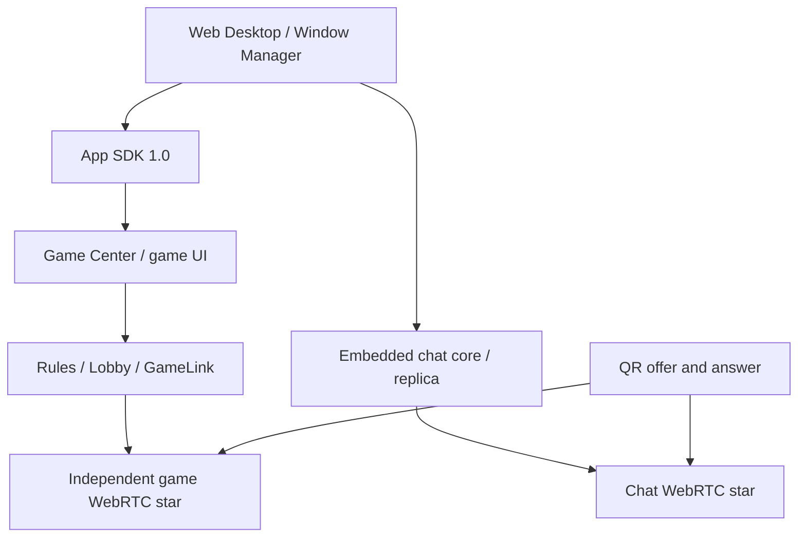

# 当前客户端架构（V3.1.2）

源码：[client/Blackmi_OS_V3.1.2_NoticeSafe.html](client/Blackmi_OS_V3.1.2_NoticeSafe.html)。以下行号对应审查基线 a7e82db，后续版本会变化。

- 外层桌面管理窗口、Dock、Launchpad、主题、通知、活动监视器；聊天核心嵌入 blackmi-core-source JSON（约 L112），不是另行部署的服务。不得随意重写嵌入核心或桥接。
- SDK 注册与生命周期 L210–241；本地事件按应用隔离，内存会话存储。仅前台运行 onFrame。
- GameLink 独立 QR 库与 Link 类（L1856–1870），DataChannel label blackmi-game-v1，iceServers:[]，双向 Offer/Answer。分帧、队列、流控、速率校验已存在，不修改这些参数作为普通游戏开发。
- Lobby（L1952–1984）管理房主、成员、座位、准备、对局、评论、快照、ACK、心跳、退出；上限 8 人含房主。房主根据连接身份裁决；成员提交 action；pub 公开，privateFor(id) 每人单独快照。恶意房主不在防作弊保证内。
- 规则引擎约 L1700–1950，gameApp UI 约 L2005，titles/minPlayers/maxPlayers/Lobby.start 是新游戏接入点。普通回合制游戏走既有快照，不使用专用于绘画的 delta 或坦克实时帧。
- GameLink 全局公开对象仅 status()/diagnostics()；BlackmiApps network.capabilities().gameData=false。不能假设存在公开通用游戏注册/发送 API，详见 SDK.md。
- 聊天公共历史复制不等于永久存储或自动选主；房主离开游戏可能中止；全部退出后无保证恢复。协议历史见 docs/RTC-ARCHITECTURE.md（V1/V2，非最新版协议规格）。
- 黑屏是应用内遮罩，不控制设备电源，不修改宿主；底部安全区保留宿主 AI 提示。服务器提案见 docs/CORE-DESIGN.md，未实现。
