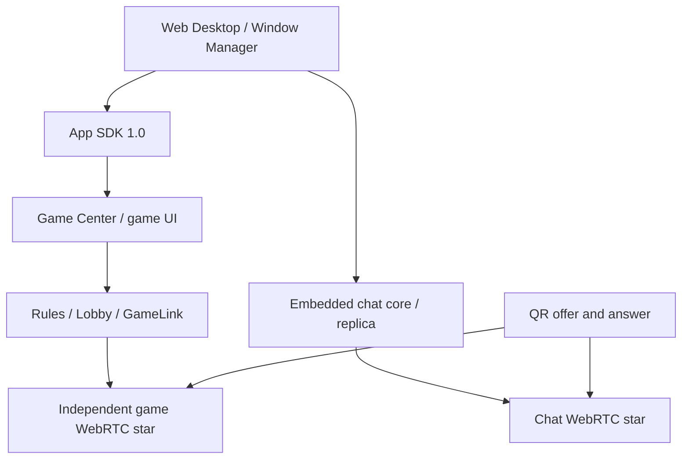
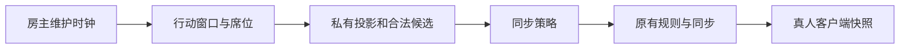

# 当前客户端架构（V3.2.1）

源码：[client/Blackmi_OS_V3.2.1_Kingdoms.html](client/Blackmi_OS_V3.2.1_Kingdoms.html)。以下行号对应审查基线 dad7b69，后续版本会变化。

- 外层桌面管理窗口、Dock、Launchpad、主题、通知、活动监视器；聊天核心嵌入 blackmi-core-source JSON（约 L112），不是另行部署的服务。不得随意重写嵌入核心或桥接。
- SDK 注册与生命周期 L211–242；本地事件按应用隔离，内存会话存储。仅前台运行 onFrame。
- GameLink 独立 QR 库与 Link 类（L1858 起），DataChannel label blackmi-game-v1，iceServers:[]，双向 Offer/Answer。分帧、队列、流控、速率校验已存在，不修改这些参数作为普通游戏开发。
- Lobby（L2063–2097）管理房主、成员、座位、准备、对局、评论、快照、ACK、心跳、退出；上限 8 人含房主。房主根据连接身份裁决；成员提交 action；普通游戏 pub 公开，privateFor(id) 每人单独快照；ArcadeMatch 与 KingdomMatch 通过 publicFor(id) 生成逐接收方视图（L2075），避免战争迷雾状态泄露。大厅握手 lobbyRev=321。恶意房主不在防作弊保证内。
- 规则引擎约 L1700–2062，gameApp UI 约 L2119，titles/minPlayers/maxPlayers/Lobby.start 是新游戏接入点。普通回合制游戏走既有快照，不使用专用于绘画的 delta、坦克实时帧或 Arcade 实时帧。KingdomMatch（L2009 起）走事件驱动快照，不走 arcade.input/frame。
- GameLink 全局公开对象仅 status()/diagnostics()；BlackmiApps network.capabilities().gameData=false。不能假设存在公开通用游戏注册/发送 API，详见 SDK.md。
- 聊天公共历史复制不等于永久存储或自动选主；房主离开游戏可能中止；全部退出后无保证恢复。协议历史见 docs/RTC-ARCHITECTURE.md（V1/V2，非最新版协议规格）。
- 黑屏是应用内遮罩，不控制设备电源，不修改宿主；底部安全区保留宿主 AI 提示。服务器提案见 docs/CORE-DESIGN.md，未实现。

## V3.2.2 开发候选

[候选 HTML](client/Blackmi_OS_V3.2.2_DeveloperSDK.html) 在外层导出 `BlackmiSDK`。本地应用沿用 window manager 和 App SDK，并在已有生命周期上增加按需绘制。受信任的内嵌回合制模块以单份定义注册人数、封面、规则工厂与窗口。

房主在 `Lobby.start` 使用 SDK 规则适配器创建对局。`Lobby.sync` 沿用逐接收方快照，分开序列化公共投影与玩家自己的私有数据。观战者公共投影的身份参数为 `null`，私有数据为空。已有动作、ACK、评论、断线、结束与座位机制继续负责同步。大厅握手仍为 321。注册模块的客户端应使用同一份打包文件。

已将聊天嵌入内容、聊天桥接、GameLink `Link`、二维码和 Lobby 配对握手同 V3.2.1 做逐字节比对。应用层快照在整批投影通过长度校验后派发，发送失败时结束对局并同步清空。接入详见 [SDK.md](SDK.md)。

## V3.4 AI Arena 开发候选

运行时分为真实成员 `Lobby.players`、设备连接 `Lobby.links`、房主的虚拟座位注册表和当前游戏的参赛 ID。虚拟 ID 是房主生成的 带 `bot-` 命名空间、随机前缀及房主本地计数，真人连接身份仍由冻结的握手分配。赛前元数据随 `setup.bots` 同步，局内随 `state.bots` 同步，包括 ID、显示名、难度和性格，席位顺序从原座位表或 `state.players` 获取。没有 AI 时省略该字段。混合联机使用同版 V3.4 HTML。

策略在独立作用域内对复制且冻结的 JSON 投影做计算。主时间窗和轮转属于各游戏适配器。AI 的结果通过 `Lobby.action` 走原有规则验证和逐接收人投影。AI 无连接、网络 ACK 或协议身份。失败通过原有 SDK 结束对局和清空状态。五个策略共享唯一待执行动作，调度与 UI 的可见性独立。[接入细节](sdk/bots/README.md)
