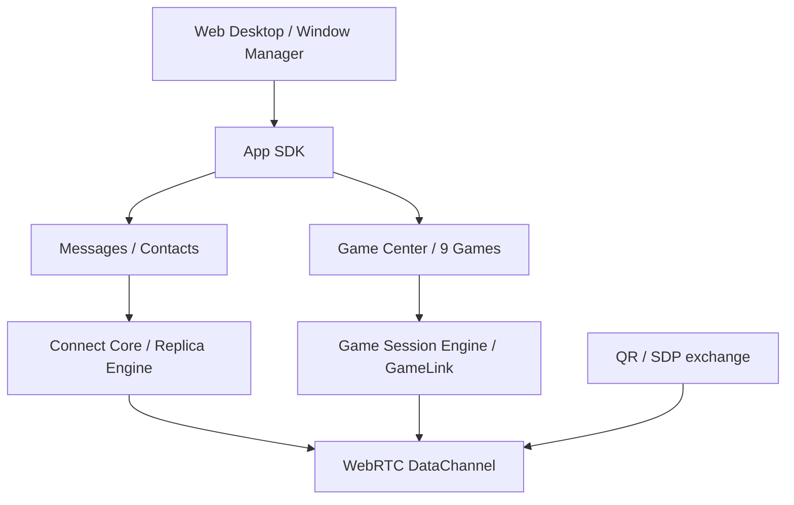

# Blackmi OS

**V2.9 Party Edition · Local-first Web Desktop**

面向 Android WebView 与普通浏览器的单文件 HTML 桌面应用平台。Blackmi OS 将局域网即时通信、独立应用窗口、会话内状态复制和多人游戏集成在同一份 HTML 中。它不是 Android ROM，也不是可刷入设备的操作系统。

## 最新版本

| 项目 | 信息 |
| --- | --- |
| 版本 | V2.9 Party Edition · CoverFix |
| 发布日期 | 2026-11-27 |
| 文件大小 | 435,083 bytes（约 425 KiB） |
| 技术栈 | HTML / CSS / JavaScript / Canvas / WebRTC DataChannel |
| 运行方式 | 单文件，无需安装前端依赖或专用后端 |
| 大厅人数 | 最多 8 人 |
| 发布状态 | 开发版；V2.9 真实多人联机与目标 WebView 验收待完成 |

**[下载最新版 HTML](https://raw.githubusercontent.com/xiaoblackmi/Blackmi-os/main/client/Blackmi_OS_V2.9_CoverFix.html)** · [查看源码](client/Blackmi_OS_V2.9_CoverFix.html)

本次 CoverFix 仅调整新游戏卡片配色，保留原有脚本。最新文件 SHA-256：

```text
8009d91ae0fe2c4a07bafaf81a4278b22e055a31aa5c80e2e1a54ea9001d2cb4
```

## 功能

- **桌面系统**：状态栏、Dock、应用中心、窗口管理、通知、主题、应用内黑屏与点击恢复。
- **即时通信**：群聊、私聊、频道、昵称头像、引用回复、提及、未读提示、搜索、压缩图片消息。
- **局域网连接**：WebRTC DataChannel 星型连接、二维码/文本信令交换、独立游戏大厅。
- **状态复制**：聊天公共历史、哈希链、检查点、内存副本与人工房间恢复；并非自动选主或持久化数据库。
- **应用框架**：应用注册、窗口生命周期、事件与帧循环管理。
- **兼容性**：旧 Chromium 布局适配、触摸坐标映射、增量消息渲染、复制防拖拽补丁、活动监视器与诊断报告。

## 游戏中心

九款游戏共用一个游戏大厅；玩家和观战者分离，支持对局评论。隐藏手牌、答案等私有信息采用定向发送，仍须信任房主裁判。

| 游戏 | 人数 | 玩法与实现范围 |
| --- | --- | --- |
| 五子棋 | 2 | 15×15 棋盘、胜负判定、认输、重开 |
| 你画我猜 | 3–8 | 600 词库、实时笔迹、轮换画师、计分 |
| 斗地主 | 3 | 发牌、叫地主、牌型校验、虚拟积分 |
| 德州扑克 | 2–8 | 公共牌、私有手牌、边池与虚拟积分 |
| 中国象棋 | 2 | 合法走子、将军、将死、困毙 |
| 八球台球 | 2 | 2D 碰撞、进球、犯规与简化八球规则 |
| 传话画画 | 4–8 | 全员同时提交，文字与绘画交替传递，作品链回放 |
| 谁是卧底 | 4–8 | 私密词语、轮流描述、秘密投票、淘汰结算 |
| UNO 彩色纸牌 | 2–8 | 108 张牌、颜色与数字匹配、功能牌、换色 |

所有纸牌游戏仅用于休闲娱乐，积分无现金价值，无充值、提现或兑换。UNO 使用不叠加罚抽的规则，暂不提供漏喊惩罚和质疑；象棋未覆盖专业长将长捉裁决，八球未模拟高级旋转球。

## 快速开始

1. 下载最新 HTML，在支持 WebRTC 的浏览器或设备管理方允许的 WebView 中打开。
2. 参与设备使用同一版本，接入彼此可达且获授权的局域网。
3. 聊天：在连接中心创建房间，通过连接码或二维码交换信令，完成双向配对。
4. 游戏：打开游戏中心，创建或加入独立游戏大厅；房主选择已准备的成员开始对局。
5. 结束对局后可留在同一个游戏大厅继续游戏，无需为每款游戏重新配对。

二维码识别可依赖系统文件选择器拍照或导入图片；直接摄像头访问并非所有宿主都允许。没有 ICE 候选或局域网设备隔离时，不能保证连接成功。请遵守设备管理和网络访问规定。

## 架构



聊天网络与游戏网络是独立的连接实例。游戏房主负责规则判定和公共状态同步。默认不配置 STUN/TURN 服务器，依赖可达的本地网络。

**核心冻结原则：** WebRTC Transport、ICE/SDP、二维码编解码和聊天协议不随普通应用功能迭代而重构；必要的兼容性和安全修复须单独审查。游戏规则、界面和大厅业务可以继续扩展。

## 版本演进

| 版本 | 主要变化 |
| --- | --- |
| V1 / V2 | 双人通信、星型多人聊天 |
| V2.5–2.6 | 公共状态备份、桌面与应用框架 |
| V2.7–2.7.3 | 游戏大厅、四款游戏、图片聊天、退出修复、黑屏 |
| V2.8 | 象棋、八球、观战与评论 |
| V2.8.1–2.8.4 | 复制兼容、增量渲染、触屏和输入法稳定性 |
| V2.8.4.1–2.8.4.2 | 网页层防拖拽补丁、600 词词库 |
| V2.9 | 传话画画、谁是卧底、UNO |
| V2.9 CoverFix | 三款新增游戏卡片对比度修复 |

这是开发演进记录，不代表每个中间构建都已经归档到 GitHub。

## 验收与已知限制

| 项目 | 状态 |
| --- | --- |
| V1 双人聊天 | 历史实机成功（操作者报告） |
| V2 群聊 | 历史 8 台实机成功（操作者报告，持续时长未记录） |
| Core Lab 1.0 | 历史 7 对本机 DataChannel、112/112 ACK（非 Wi-Fi 吞吐测试） |
| V2.7 首批三款游戏 | 操作者报告可用 |
| V2.9 新游戏 | 开发记录包含模拟对局及两种横屏 UI 测试，非真实联机验收 |
| V2.9 CoverFix | 本次发布已核对脚本不变、GitHub 文件与本地字节一致；未新增实机测试 |
| 目标设备 | 历史 C6 / Android 9 / Chromium 80 WebView；834×360、960×600 为适配目标 |
| 剪贴板 | 受宿主权限和原生选区实现限制；防拖拽补丁不能保证拦截系统层拖放 |
| 持久化 | 宿主可能限制存储，完全退出后数据可能丢失 |
| 房主离线 | 游戏对局可能终止；不支持自动选主或无感恢复 |
| ESP32 常驻 Core、AI | 未来设计，未实现或验收 |

## 仓库结构

```text
client/     已归档客户端与最新版 HTML
archive/    历史原型与实验
labs/       能力与通信测试工具
docs/       设计、历史、设备测试及安全文档
tests/      历史测试数据
```

- [开发演进与源码索引](docs/HISTORY.md)
- [设备画像、权限及历史实测](docs/DEVICE-TESTS.md)
- [历史 V1/V2 通信机制](docs/RTC-ARCHITECTURE.md)
- [未来常驻 Core 架构](docs/CORE-DESIGN.md)
- [历史 UI 规格](docs/FRONTEND.md)
- [开发与验收路线](docs/ROADMAP.md)
- [测试数据 CSV](tests/core-lab-rtc.csv)
- [安全和公开发布说明](docs/SECURITY.md)

以上链接中的早期架构文档仍保留历史版本语境，以本 README 标注的最新版范围为准。

## 安全与授权

本项目面向获授权的网络与运行环境，不改变设备管理策略，不提供通用代理，也不保证突破宿主的权限限制。不要在公开仓库提交个人资料、访问密钥或真实会话信令。房主能够访问裁判所需状态，本系统不宣称具备针对恶意房主的端到端保密或完全防作弊能力。

保留 AI 来源标识及第三方代码原有授权声明。项目整体许可证尚待所有者确定；公开可见并不等同于采用开源许可证。

---

Blackmi OS · Local-first communication, applications and multiplayer games.
