<div align="center">

# Blackmi OS

**一个 HTML 文件，一张局域网，一个属于自己的多人应用空间。**


### [⬇️ 下载最新版](https://raw.githubusercontent.com/xiaoblackmi/Blackmi-os/main/client/Blackmi_OS_V3.1.2_NoticeSafe.html) · [📖 查看源码](client/Blackmi_OS_V3.1.2_NoticeSafe.html) · [🐛 反馈问题](https://github.com/xiaoblackmi/Blackmi-os/issues)

*Local-first communication, applications and multiplayer games.*

<a href="docs/assets/screenshots/Blackmi_3.1.2_client_desktop.jpg">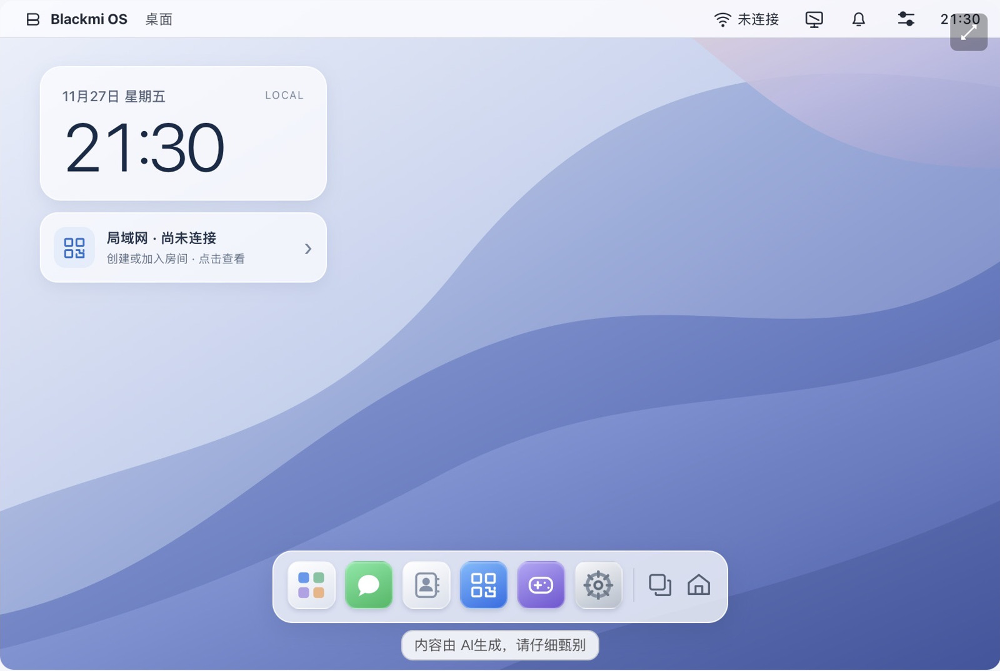</a>

*V3.1.2 Refined · Notice Safe | 2026-11-27 客户端预览*

</div>

> Blackmi OS 是面向浏览器及 Android WebView 的单文件 Web 桌面应用平台，而不是 Android ROM。它无需安装额外的前端依赖或专用后端，在支持 WebRTC 且设备彼此可达的获授权网络中即可尝试使用。
>
> 当前 V3.1.2 Refined · Notice Safe 为开发版，优先适配 834×360 超宽屏 WebView。上图为用户提供的实际客户端预览截图，不是设计效果图，也不是 C6 实机联机验收。

---

## 🧭 快速导航

[界面展示](#-界面实录--screenshots) · [功能介绍](#-你可以做什么) · [快速上手](#-快速上手) · [游戏图鉴](#-游戏图鉴) · [技术架构](#-技术架构) · [版本与验收](#-版本与验收)

## 🆕 V3.1.2 · Refined / Notice Safe

| 桌面 | 应用与游戏 | 兼容性 |
| :--- | :--- | :--- |
| macOS 风格悬浮 Dock、渐变图标、时间与连接组件、浅深色主题 | Launchpad 中英文搜索、10 款游戏、开局前选择参赛座位或观战 | 25px 紧凑菜单栏、36px 小屏 Dock 底部间距、壁纸等比覆盖；为宿主 AI 提示保留可见空间 |

3.1.2 在 3.1.1 上仅追加 CSS 安全区并更新 HTML 标题，所有脚本逐字节一致。宿主显示的 AI 提示不属于网页 DOM，保持其可见与原样显示，不删除、遮挡或伪造来源标识。小屏 Dock 底部间距为 36px，其他视口为 40px；最大化窗口同步预留空间，键盘布局保留原处理。

## 📸 界面实录 / Screenshots

**一个桌面，多个应用。** 以下四张截图来自 2026-11-27 用户客户端预览，仅裁剪外部预览页面边缘，保留界面内容及宿主 AI 来源提示。点击图片可查看原图。

| Desktop · 桌面 | Launchpad · 应用中心 |
| :---: | :---: |
| <a href="docs/assets/screenshots/Blackmi_3.1.2_client_desktop.jpg"></a> | <a href="docs/assets/screenshots/Blackmi_3.1.2_client_launchpad.jpg">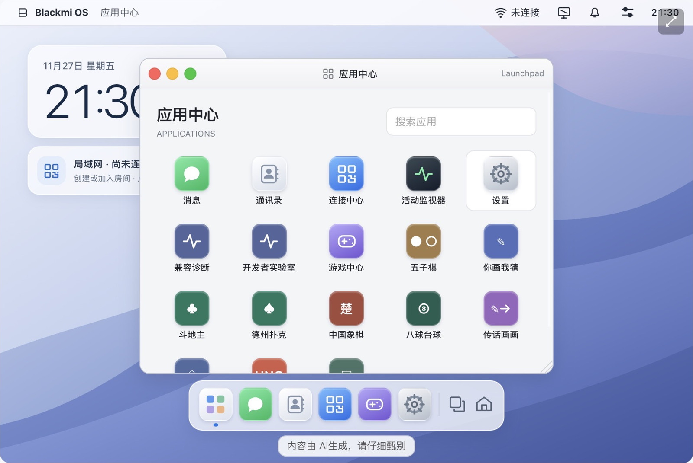</a> |
| 时间组件 · 悬浮 Dock · 局域网状态 | 应用网格 · 中英文搜索 |

| Messages · 即时通信 | Game Center · 游戏中心 |
| :---: | :---: |
| <a href="docs/assets/screenshots/Blackmi_3.1.2_client_messages.jpg">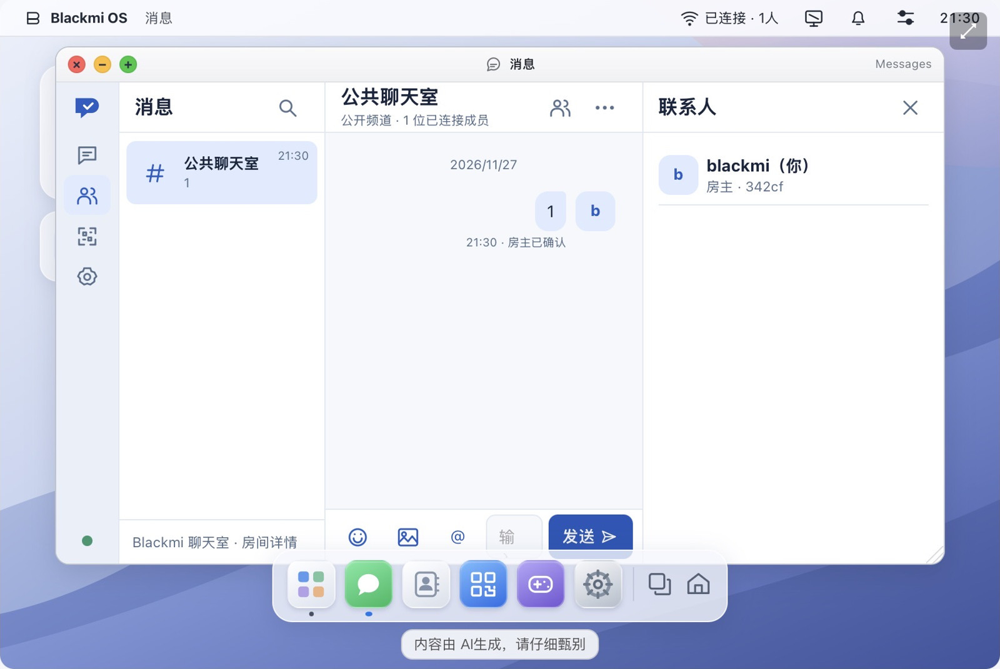</a> | <a href="docs/assets/screenshots/Blackmi_3.1.2_client_game-center.jpg">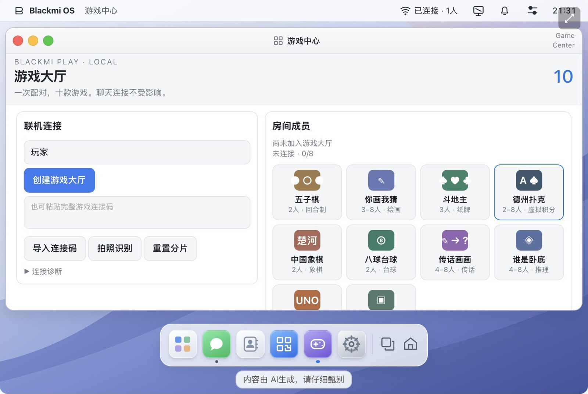</a> |
| 公共聊天室 · 联系人 · 消息输入 | 10 款游戏 · 联机大厅 |

> 客户端预览中，桌面、应用中心、消息与游戏中心均可打开，宿主 AI 提示位于 Dock 下方。消息截图仅显示单人成员，不能作为跨设备联机验收。目标 Android 9 / Chromium 80 PAD 仍待实机复测。

<details>
<summary><b>查看开发机运行截图（834×360 Chromium）</b></summary>

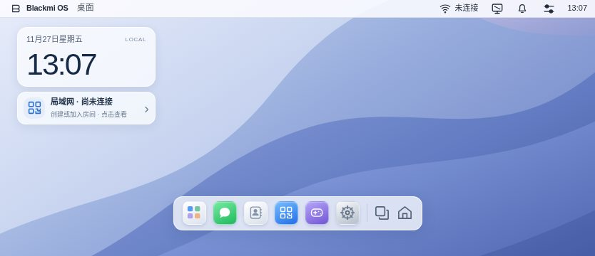

| Launchpad | Game Center |
| :---: | :---: |
| 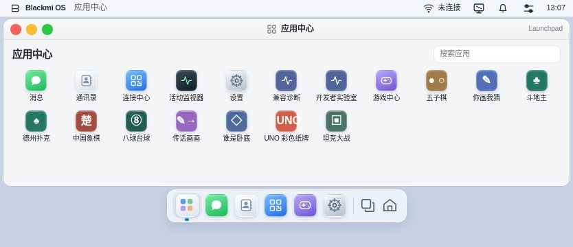 | 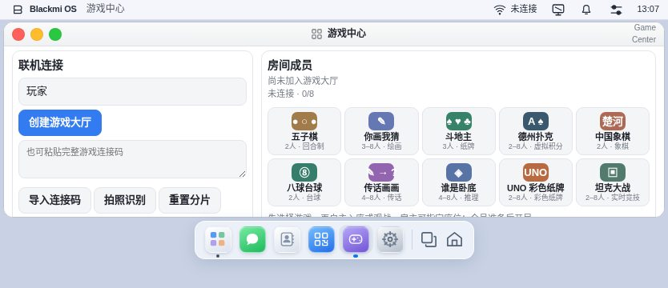 |

</details>

<details>
<summary><b>查看历史客户端预览与底部安全区对比</b></summary>

| V3.1.1 用户客户端预览 | V3.1.2 开发机模拟提示 |
| :---: | :---: |
| 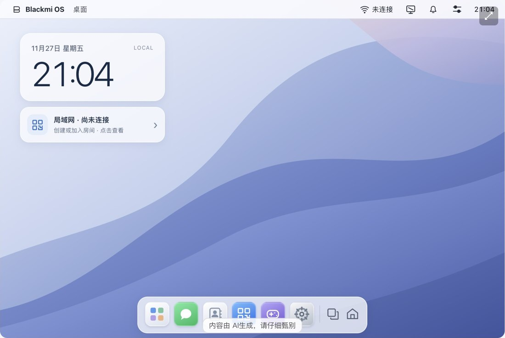 | 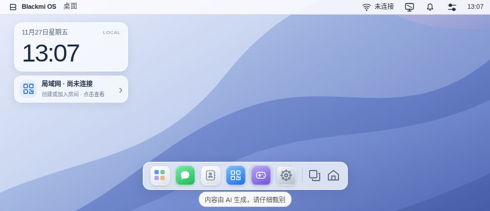 |
| 原 AI 提示保留，仅裁剪外部预览 | 模拟提示仅用于测试，不属于发布 HTML |

真实宿主提示的位置、字体与高度可能随客户端版本变化。

</details>

## ✨ 你可以做什么？

| 💬 即时通信 | 🎮 游戏中心 | 🖥️ 桌面体验 |
| :--- | :--- | :--- |
| 群聊、私聊、频道、图片、引用回复、@成员、消息搜索 | 10 款联机游戏，最多 8 人大厅，支持观战与对局评论 | Dock、窗口管理、主题、通知中心、活动监视器、应用内黑屏 |

| 🔗 本地连接 | 🧩 应用框架 | 🛟 会话恢复 |
| :--- | :--- | :--- |
| WebRTC 点对点传输，二维码与文本交换信令 | 独立应用注册、生命周期、事件总线、帧循环管理 | 公共聊天历史内存复制、检查点、哈希链与人工恢复 |

## 🚀 快速上手

**准备工作：** 两台或更多设备、同一个版本的 HTML、设备之间能够通信的获授权局域网。普通现代浏览器可作为开发或测试环境；受限 WebView 的功能取决于宿主权限。

### 01｜下载并打开

1. 点击上面的 **下载最新版**，保存为 `Blackmi_OS_V3.1.2_NoticeSafe.html`。如果浏览器只显示源码，使用浏览器的保存文件功能。
2. 在支持 WebRTC 的浏览器或管理方允许的 WebView 中打开该 HTML。文件预览器不一定执行 JavaScript。
3. 看到 Blackmi OS 桌面后，点击「消息」或「游戏中心」。

> [!TIP]
> 所有参与者使用相同版本。无需 npm、Python 服务或 ESP32；本地文件能打开不代表设备之间一定能够建立 WebRTC 连接。

### 02｜两台设备开始聊天

| 🖥️ 房主 A | 📱 成员 B |
| :--- | :--- |
| 打开「消息」，输入昵称和房间名，点击「创建房间」 | 打开「消息」，输入昵称，点击「导入邀请」 |
| 在「连接中心」点击「生成成员邀请」 | 使用「拍照/选择二维码」或「手动导入连接码」导入 A 的邀请 |
| 等待 B 生成应答 | 展示应答二维码，或提供完整连接码 |
| 导入 B 的应答，等待连接确认 | 等待成员身份确认和公共历史同步 |
| 发送第一条消息 | 收到消息后回复 |

### 03｜理解双向配对（很重要）

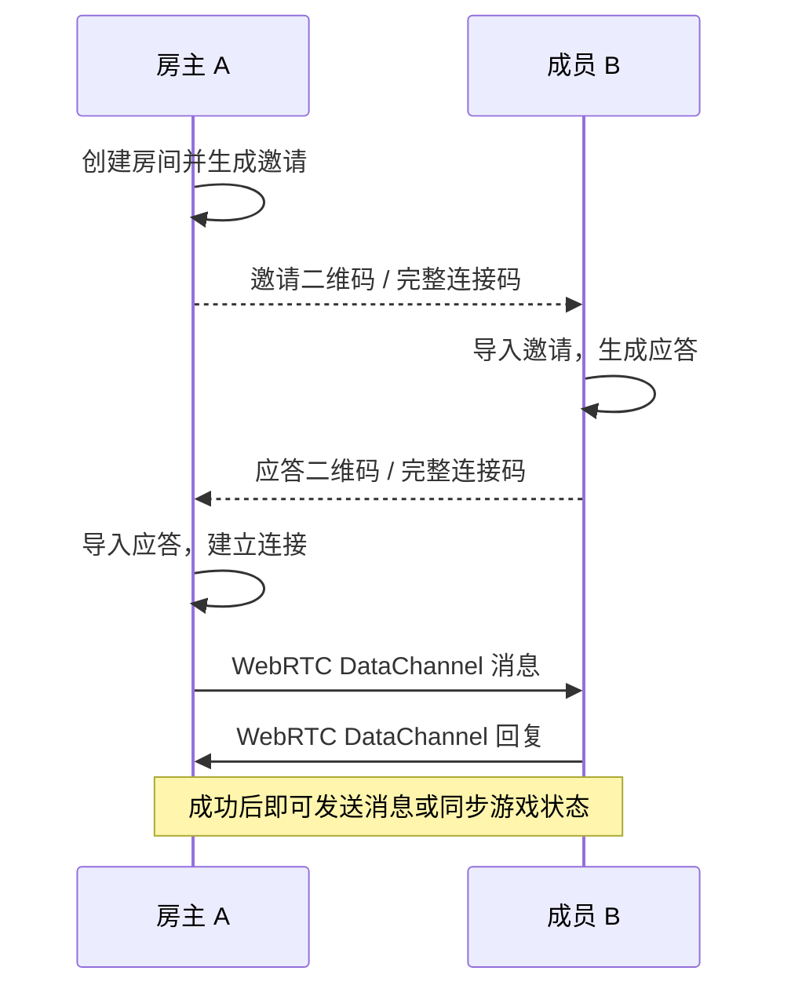

**扫码不是单向登录。** 邀请和应答必须成对交换，缺少最后一步就可能一直停留在等待连接状态。

- 二维码可能被拆为多张，使用「上一张」「下一张」逐一识别，直至分片收齐。
- 不方便拍照时，展开完整连接码，复制并导入对方设备。
- 每加入一名新成员，房主应生成新的邀请并完成对应配对。不要混用不同邀请的分片或旧应答。
- 本项目默认不配置 STUN/TURN，连接是否成功取决于网络可达性与 WebView 能力。

### 04｜创建第一场联机游戏

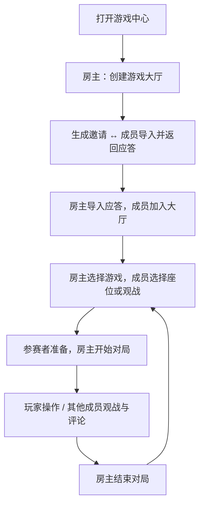

| 操作 | 在哪里点击 |
| :--- | :--- |
| 创建大厅 | 游戏中心 → 创建游戏大厅 |
| 邀请成员 | 生成邀请 → 邀请二维码 / 完整连接码 |
| 加入大厅 | 拍照识别 / 导入连接码，生成应答并交回房主 |
| 开始对局 | 房主选择游戏 → 成员选择参赛座位或观战 → 参赛者准备 → 房主开始对局 |
| 旁观朋友 | 已有对局 → 进入观战 |
| 换一种游戏 | 房主「结束对局」→ 选择新的游戏 |
| 离开 | 退出大厅 |

> [!NOTE]
> 游戏大厅和聊天房间是独立连接。加入聊天不等于加入游戏大厅；游戏大厅只需配对一次，正常结束一局后可以继续在同一大厅开新游戏。

---

## 🎮 游戏图鉴

**不知道玩什么？按人数选就行。**

| 人数 | 推荐 |
| :--- | :--- |
| 2 人 | 五子棋、中国象棋、八球台球、UNO、坦克大战 |
| 3 人 | 斗地主、你画我猜、UNO |
| 4–8 人 | 传话画画、谁是卧底、你画我猜、UNO、德州扑克、坦克大战 |

### 🆕 多人聚会与竞技游戏

| 游戏 | 人数 | 怎么玩 |
| :--- | :---: | :--- |
| 🖍️ **传话画画** | 4–8 | 所有人同时写句子、画图、猜图，最后揭晓完整传话作品链 |
| 🕵️ **谁是卧底** | 4–8 | 获取秘密词语，轮流描述，秘密投票找出卧底 |
| 🌈 **UNO 彩色纸牌** | 2–8 | 匹配颜色或数字，使用功能牌，率先出完手牌 |
| 🕹️ **坦克大战** | 2–8 | 虚拟坦克竞技，实时操控与对局状态同步 |

### 经典游戏

| 游戏 | 人数 | 实现范围 |
| :--- | :---: | :--- |
| ⚫ 五子棋 | 2 | 15×15 棋盘、自由规则判胜、认输、重开 |
| 🎨 你画我猜 | 3–8 | 600 词库、实时笔迹、轮换画师、限时计分 |
| 🃏 斗地主 | 3 | 发牌、叫地主、牌型校验、虚拟积分 |
| ♠️ 德州扑克 | 2–8 | 公共牌、私有手牌、最佳牌型、边池结算 |
| ♟️ 中国象棋 | 2 | 合法走子、将军、将死、困毙 |
| 🎱 八球台球 | 2 | 二维碰撞、进球、犯规、简化八球规则 |

**规则说明：** UNO 不叠加罚抽，暂不包含漏喊惩罚及质疑；象棋未覆盖赛事级长将、长捉裁决；八球暂不支持高级旋转球。纸牌积分仅用于休闲娱乐，没有现金价值，不提供充值、提现或兑换。

观战者能够查看公开状态和评论，但不应收到其他玩家的隐藏手牌或秘密答案。房主仍是可信裁判。

## 🛠️ 常见问题 FAQ

<details>
<summary><b>一直显示等待连接 / ICE disconnected？</b></summary>

确认设备在同一获准网络内且相互可达、双方版本相同、邀请和应答已完整导入。部分网络存在客户端隔离或本地通信限制，可在管理方允许的测试网络中复测。打开游戏大厅的「连接诊断」查看实际状态。不要反复导入已失效的应答。

</details>

<details>
<summary><b>二维码扫描失败，或者无法直接使用摄像头？</b></summary>

使用系统文件选择器拍照或选择清晰图片。检查是否还有未识别的分片；混入另一组二维码时使用「重置分片」（游戏大厅）或「清除分片」（聊天）。直接摄像头访问可能被宿主禁止。

</details>

<details>
<summary><b>复制消息时卡住，或者提示宿主不允许复制？</b></summary>

使用复制弹窗的系统文本选择菜单；选中后直接复制，避免拖拽已选文字。当前网页层防拖拽补丁无法保证阻止宿主原生拖放。如果仍有异常，记录设备和 WebView 版本，报告问题。完全退出页面可能丢失会话数据。

</details>

<details>
<summary><b>为什么游戏不能开始？其他人只能观战？</b></summary>

只有房主能够开始对局，且已准备人数必须满足游戏要求。双人游戏需明确选择两位参赛者的座位，未入座成员可观战。当前一个游戏大厅同时仅支持一场对局。

</details>

<details>
<summary><b>房主离开后，聊天和游戏会怎样？</b></summary>

游戏对局可能中止。聊天公共历史具备会话内副本与人工恢复能力，但不是自动选主、自动重连或永久存储。全部设备退出后不能保证恢复。

</details>

<details>
<summary><b>一键黑屏是真的关屏吗？</b></summary>

不是。右上角屏幕图标启用应用内黑色遮罩，点击恢复原界面，不主动断开连接；不控制设备电源或宿主 UI。

</details>

<details>
<summary><b>如何反馈兼容性问题？</b></summary>

打开「活动监视器 → 兼容诊断」，记录版本、设备、视口、操作步骤、预期与实际结果，再提交 Issue。不要公开真实连接码、SDP、个人聊天内容、设备唯一标识或密钥。

</details>

---

## 🏗️ 技术架构

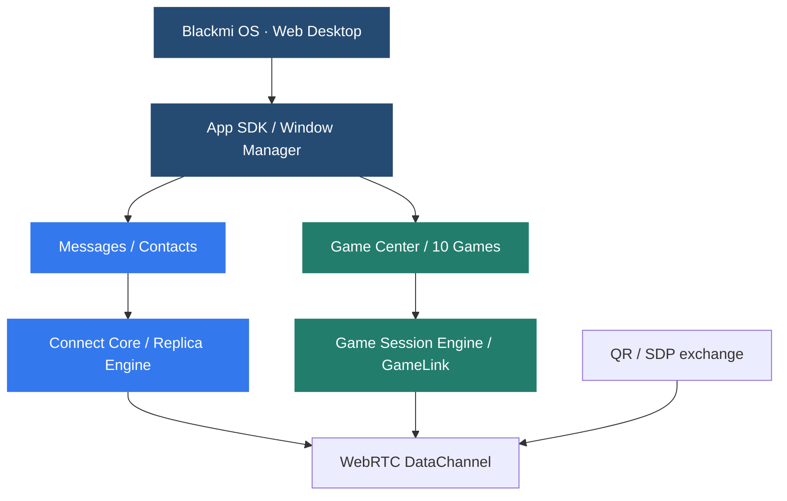

- **传输层：** 两套独立的 WebRTC 星型连接，房主与成员直接通信，房主负责转发或裁判。
- **应用层：** 独立窗口与生命周期、游戏状态机、公开与私有状态分离。
- **复制层：** 聊天公共历史内存副本、哈希链、检查点与人工恢复。
- **开发原则：** 核心架构继续冻结；WebRTC Transport、ICE/SDP、二维码编解码与聊天协议不随普通应用扩展重构。必要安全及兼容性修复须单独审查。

## 📋 版本与验收

| 项目 | 当前信息 |
| :--- | :--- |
| 最新构建 | V3.1.2 Refined · Notice Safe |
| 日期 | 2026-11-27 |
| 文件大小 | 509,138 bytes（约 497 KiB） |
| 技术栈 | HTML / CSS / JavaScript / Canvas / WebRTC |
| 适配目标 | 历史 C6 / Android 9 / Chromium 80 WebView；834×360、960×600 横屏 |
| 发布状态 | 开发版，V3.1.2 目标 PAD 实机多人联机待验收 |

| 测试项目 | 状态 |
| :--- | :--- |
| V1 双人聊天 | ✅ 历史实机成功（操作者报告） |
| V2 星型群聊 | ✅ 历史 8 台实机成功（操作者报告，持续时长未记录） |
| Core Lab 1.0 | ✅ 历史 7 对本机 DataChannel，112/112 ACK；非 Wi-Fi 吞吐测试 |
| V2.7 首批三款游戏 | ✅ 操作者报告可用 |
| V2.9 新游戏 | 🧪 开发记录含模拟对局与两种横屏 UI 测试，非真实联机验收 |
| V2.9 CoverFix | 🧪 三款游戏卡片配色修复；脚本比对一致，源码上传完整性校验通过 |
| V2.9 C6 多人联机 | ⏳ 待实机验收 |
| V3.1.1 视口适配 | 🧪 开发记录：三种视口模拟、应用中心启动正常，非旧版 WebView 实机测试 |
| V3.1.1 通信与游戏 | ⏳ 继承原核心，目标 PAD 实机回归待验收 |
| V3.1.2 安全区 | 🧪 834×360 Chromium 实运行：桌面、Launchpad、游戏中心可打开；模拟提示不遮挡 Dock |
| V3.1.2 脚本与来源标识 | ✅ 所有脚本与 3.1.1 逐字节一致，原 AI 来源元数据保留 |
| ESP32 常驻 Core、AI | 📝 规划阶段，未实现或验收 |

<details>
<summary><b>查看版本演进与文件校验值</b></summary>

| 版本 | 主要变化 |
| :--- | :--- |
| V1 / V2 | 双人通信、星型多人聊天 |
| V2.5–2.6 | 公共状态备份、桌面与应用框架 |
| V2.7–2.7.3 | 游戏大厅、四款游戏、图片聊天、退出修复、黑屏 |
| V2.8 | 象棋、八球、观战与评论 |
| V2.8.1–2.8.4 | 复制兼容、增量渲染、触屏与输入法优化 |
| V2.8.4.1–2.8.4.2 | 网页层防拖拽补丁、600 词词库 |
| V2.9 | 传话画画、谁是卧底、UNO |
| V2.9 CoverFix | 三款新增游戏卡片对比度修复 |
| V3.0 | Lite 桌面、参赛座位选择、坦克大战 |
| V3.1 | Refined 视觉重构、Launchpad 搜索 |
| V3.1.1 | Viewport Fit：超宽屏、壁纸覆盖与紧凑布局 |
| V3.1.2 | Notice Safe：宿主提示安全区与截图文档 |

版本演进不代表所有中间构建均已归档至 GitHub。历史 [V2.9 CoverFix](client/Blackmi_OS_V2.9_CoverFix.html) 仍可下载。[V3.1.1 Viewport Fit](client/Blackmi_OS_V3.1.1_ViewportFit.html) 也保留。

SHA-256（V3.1.2，原始文件校验）：

```text
9f5e9e857fb7b6282e469ddb573f256836f5413813f5111171ccba3ece2fff36
```

Git Blob SHA：

```text
427c79f42be77e7928a4f14d27248ac0526e6231
```

</details>

## 📂 仓库导航

```text
client/      已归档客户端与最新版 HTML
archive/     历史原型与实验
labs/        能力与通信测试工具
docs/        设计、历史、设备测试与安全文档
  assets/    README 插图及运行截图
tests/       历史测试数据
```

| 想了解什么？ | 阅读 |
| :--- | :--- |
| Codex / AI 开发规范（先读） | [AGENTS.md](AGENTS.md) |
| 跨会话交接与当前基线 | [PROJECT_CONTEXT.md](PROJECT_CONTEXT.md) |
| 当前客户端架构 | [ARCHITECTURE.md](ARCHITECTURE.md) |
| App SDK 与游戏接入 | [SDK.md](SDK.md) |
| 版本及证据 | [CHANGELOG.md](CHANGELOG.md) |
| 发布与测试门槛 | [TESTING.md](TESTING.md) |
| 项目怎么发展到今天 | [开发演进与源码索引](docs/HISTORY.md) |
| 设备到底支持什么 | [设备画像、权限及历史实测](docs/DEVICE-TESTS.md) |
| WebRTC 如何建立连接 | [历史 V1/V2 通信机制](docs/RTC-ARCHITECTURE.md) |
| ESP32 与未来架构 | [常驻 Core 设计](docs/CORE-DESIGN.md) |
| 客户端交互设计 | [历史 UI 规格](docs/FRONTEND.md) |
| 后续开发与验收 | [开发路线图](docs/ROADMAP.md) |
| 原始历史测试数据 | [测试 CSV](tests/core-lab-rtc.csv) |
| 安全与公开发布 | [安全说明](docs/SECURITY.md) |

早期文档保留原有版本语境，以本 README 标注的最新版实现范围为准。

## 🔒 安全与使用边界

本项目仅面向获授权的设备、网络与运行环境，不改变设备管理或网络访问策略，不提供通用代理，不保证突破宿主权限限制。房主可访问裁判所需状态，系统不宣称能够防范恶意房主或实现完全防作弊。宿主存储限制可能导致退出后数据丢失。

保留 AI 来源标识与第三方代码原有授权声明。项目整体许可证尚待所有者确定；公开可见不等于采用开源许可证。

---

<div align="center">

**BLACKMI OS**

*Connect locally. Build freely. Play together.*

⭐ 如果项目对你有启发，欢迎 Star 或提交 Issue。

</div>
