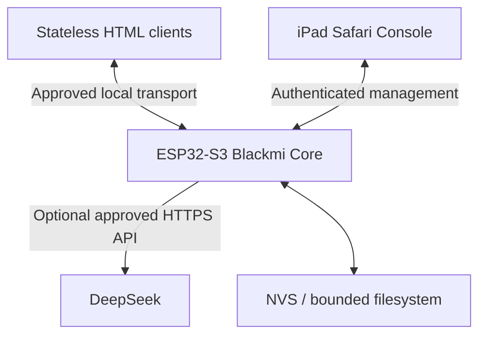

# Blackmi Core V3：常驻服务设计（提案）

## 目标
无状态 HTML 客户端退出即释放；ESP32-S3 常驻保存房间和身份；个人 iPad 独立 Console。客户端退出不导致房间解散。仅在设备和网络管理方批准访问此服务的情况下部署。

## 传输决策
首选经授权的 WebSocket/WSS 常驻通信；HTTP(S) 可用于健康检查、历史、管理。HTTP/WS 可能受 HTTPS iframe 混合内容限制；Origin=null 可能导致 CORS 或服务端 Origin 验证问题。不得关闭 TLS 证书验证、使用任意 Origin 放行或规避宿主管理策略。由网络管理方配置正式许可及信任链。若无授权兼容传输，不部署联网模式；仍可在获准的环境使用既有临时 P2P 应用。ESP-Peer/WebRTC 仅技术候选，尚无 ESP32 与平板联调或容量证据。

## 服务职责
- Network Manager：连接状态、自动恢复、看门狗、服务健康检查。
- Session / Auth：服务端账户、短期会话、角色、房间 ACL；固定 QR 仅表示服务标识/受控加入入口，不含管理员凭据。
- Room / Router：维护成员、加入离开、消息序号、去重与投递状态；客户端重启重新认证后拉取允许访问的记录。
- Storage：NVS 存小型配置；LittleFS 等文件系统分批写入有限日志，循环保留；PSRAM 用于缓存。需处理断电恢复及 Flash 磨损。
- AI Client：仅处理明确提交给 AI 的问题，HTTPS 调用授权模型，服务端保管密钥，超时、限流、队列、响应大小限制；不发送整个聊天室，不做通用网络代理。
- Admin Console：服务端鉴权、角色隔离、成员与房间管理、健康状态、AI额度和操作审计。默认不开放私人消息读取。

## 初始硬件预算（建议，非实测）
ESP32-S3 N16R8：16MB Flash、8MB PSRAM，USB供电，OLED可选。具体板卡尚未确认。Flash 分区可初步考虑固件/更新6MB、文件系统8MB、其余2MB；PSRAM 初步预算消息2MB、AI任务2MB、预留4MB。网络栈及任务仍需内部RAM，实际分区按构建和硬件测量调整。不要承诺32人稳定运行。

## 登录和恢复原则
QR 输入通过文件选择器读取照片；服务发现与账户认证分离。用户输入个人账户凭据重新登录。短期掉线可在页面存活时重连；整页重启不保留本地 token，必须重新认证，不能声称免登录。服务器保存可授权恢复的房间状态、历史游标。固定二维码仅在服务地址稳定且授权配置有效时才可长期使用。
## 风险
服务器断电、死机、Wi-Fi中断均是单点故障；需要 watchdog、断电恢复、日志上限、并发资源限制、慢连接隔离、AI工作与聊天任务隔离。普通客户端与 iPad 退出不能影响 Core 运行。
