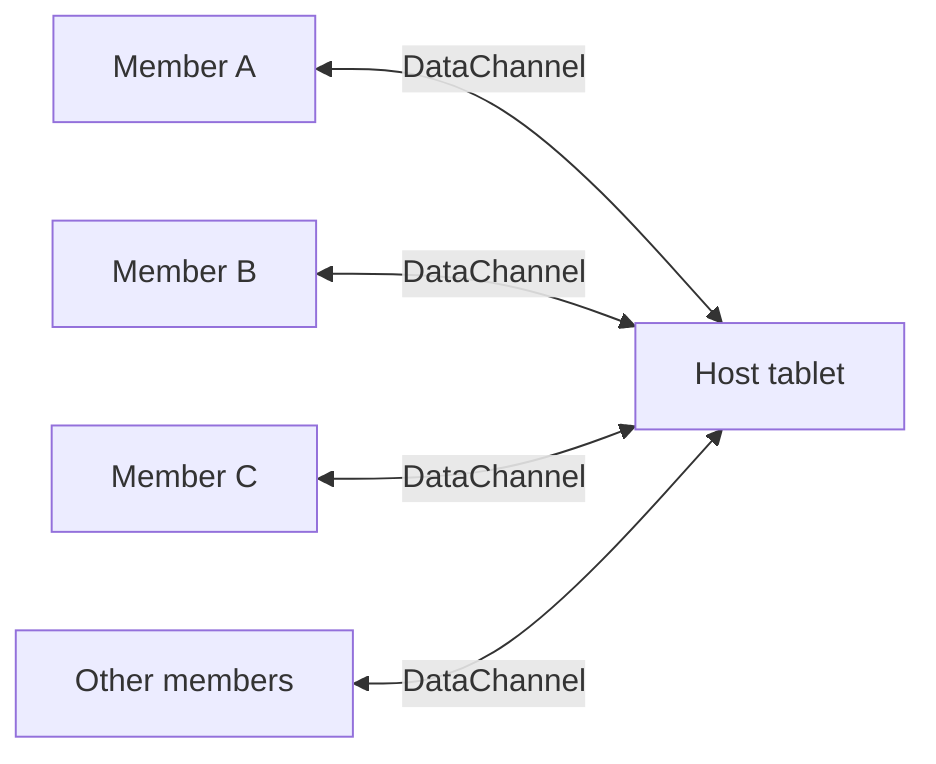

# V1/V2 WebRTC 通信架构（现有实现）

## 协议栈
原生 JS -> RTCDataChannel -> SCTP -> DTLS -> ICE 选定的传输路径（典型 UDP/IP）-> 局域网。实际候选路径没有抓包确认。DataChannel 默认可靠有序；DTLS 保护单条连接，不等于经房主转发的端到端加密。V2 房主可见群聊明文。

## V2 星型结构

N台设备需 N-1 条连接（8台7条），全互联需 N(N-1)/2（8台28条）。房主维护成员名单、生成消息ID及时间、转发消息；房主离开则房间中断。无专用服务器的模式不能自动恢复永久房间。

## 配对及信令
房主逐个生成独立 Offer，成员取得 Offer 后生成 Answer，房主读取 Answer，ICE 检查、DTLS 协商、DataChannel open 后进入握手。使用 iceServers: []，不配置 STUN/TURN。二维码交换的是会话描述，不是实际消息载荷；每次配对需新协商，不能把一次 SDP 当永久邀请码。
现有 QR 采用嵌入式编码/解码、Crockford Base32、无损 SDP 字典/数字/十六进制压缩、CRC16 检错、分帧；PL5 帧头及编号用于组装，单帧载荷最多175字符。CRC不是身份认证。嵌入第三方库许可声明保留。用户通过系统文件选择器拍摄/选取二维码照片，HTML 读取图像解码。直接 getUserMedia 不可用。
公开文档不含真实会话凭据、候选地址或可复用邀请。

## V2 应用层
| 类型 | 方向 | 含义 |
|---|---|---|
| hello | 成员->房主 | 提交昵称 |
| welcome | 房主->成员 | 确认房间和分配用户标识 |
| roster | 房主->成员 | 同步成员列表 |
| submit | 成员->房主 | 提交消息正文 |
| message | 房主->成员 | 统一生成消息ID、发送者、正文、时间戳 |
所有消息 JSON；版本字段 v=2，类型字段 t。房主根据连接对象确定发送者而不是直接信任客户端声称身份。用户昵称最长24字符；消息正文最多1000字符；接收字符串长度限制15000，bufferedAmount 超262144字节拒绝发送；内存聊天历史最多200条。成员退出更新 roster，其余已连接成员可继续通信。单邀请挂起，容量 MAX=8 含房主。
消息显示使用 textContent。无持久化登录、可信账户认证、断线恢复、离线补发、独立应用 ACK 或房主迁移；不得用于传输敏感信息。

## 开发端验收（历史）
V2 JS 语法检查通过；三客户端模拟传输验证加入、广播、退出后继续聊天；QR 编解码基本测试通过。布局测试 834×360 / 960×600 / 360×640 无横向溢出，实际桌面 RTC 三方连接未在限定时间内建立；后续操作者报告真实八台通过。两类证据分别保留，不能把模拟结果当实机结果。
